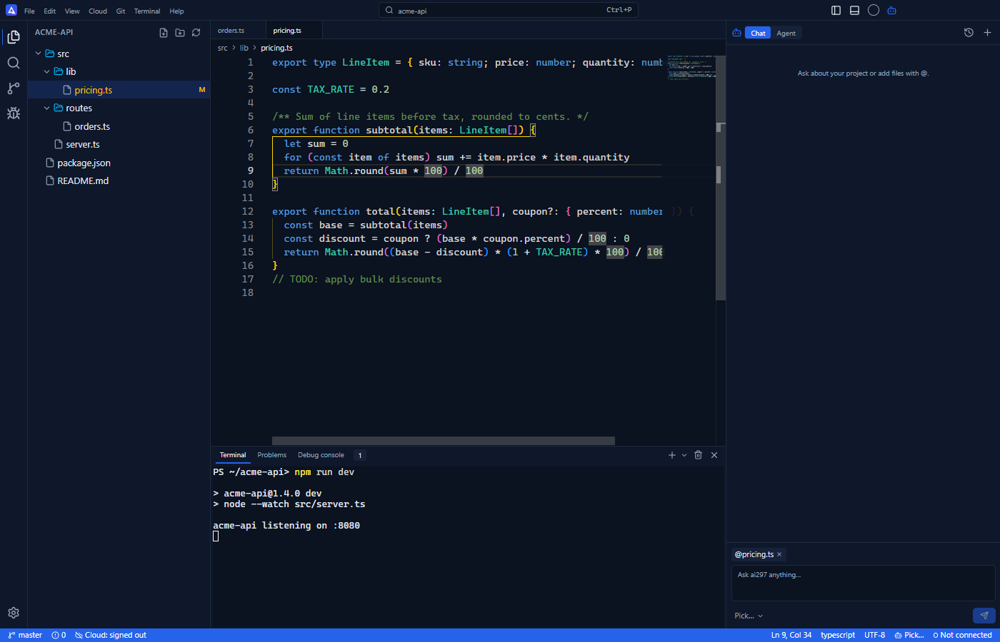
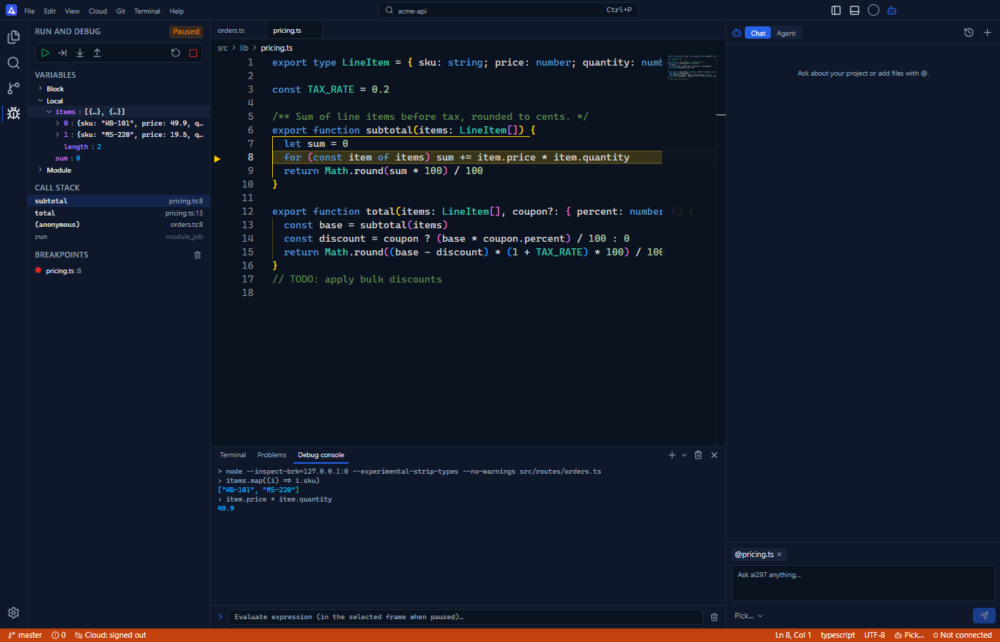
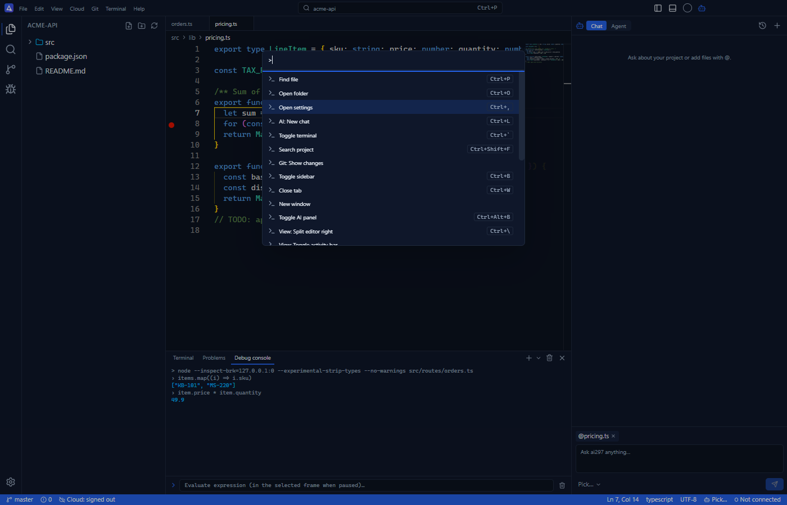
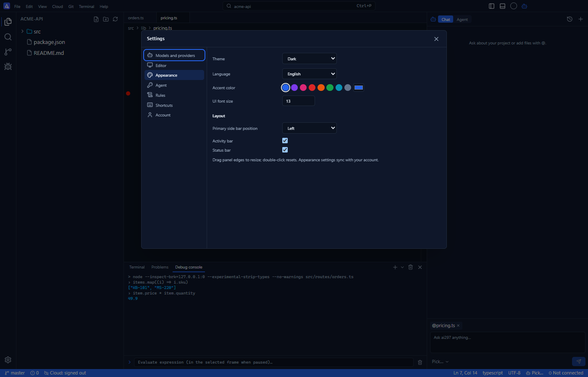

# ai297 — AI Code Editor for Windows, macOS and Linux

**ai297 is a free desktop AI code editor with a VS Code-style interface.** It understands your whole project, answers questions about your code, edits files with an AI agent (every change is shown as a diff before it is applied), and syncs your workspace to [ai297.com](https://ai297.com) so you can keep coding from any browser. The interface is available in 15 languages.

## Download

| Platform | Download | File |
|---|---|---|
| **Windows** 10 / 11 (64-bit) | [Download for Windows](https://github.com/ai297-com/ai-code-editor/releases/latest/download/ai297-Setup-x64.exe) | `ai297-Setup-x64.exe` |
| **macOS** Apple Silicon (M1, M2, M3, M4) | [Download for Mac — Apple Silicon](https://github.com/ai297-com/ai-code-editor/releases/latest/download/ai297-mac-arm64.dmg) | `ai297-mac-arm64.dmg` |
| **macOS** Intel | [Download for Mac — Intel](https://github.com/ai297-com/ai-code-editor/releases/latest/download/ai297-mac-x64.dmg) | `ai297-mac-x64.dmg` |
| **Linux** (x64) | [AppImage](https://github.com/ai297-com/ai-code-editor/releases/latest/download/ai297-linux-x86_64.AppImage) · [Debian / Ubuntu (.deb)](https://github.com/ai297-com/ai-code-editor/releases/latest/download/ai297-linux-amd64.deb) | `.AppImage`, `.deb` |

These links always point to the latest version. Release notes: [Releases](https://github.com/ai297-com/ai-code-editor/releases) · Website: [ai297.com/download](https://ai297.com/download)

## Features

- **VS Code-style editor** — Monaco editor, file explorer, project search, Git changes, draggable tabs, split editor, menus and a command palette (`Ctrl+Shift+P`).
- **AI chat that knows your project** — ask about your codebase and add files as context with `@`.
- **AI agent with diff review** — multi-step tasks that edit files and run commands, each change approved by you.
- **Inline AI edits** — select code, press `Ctrl+K`, describe the change.
- **Bring your own models** — api14, OpenAI, Anthropic Claude or any OpenAI-compatible endpoint.
- **Cloud sync and browser IDE** — a folder opened on the desktop appears in your ai297.com account; edit it from any browser and changes sync back (conflicts are kept as copies, never silently overwritten).
- **Remote worker (opt-in)** — run terminal sessions and AI agent tasks on your own computer from the web. Off by default.
- **Claude Code and Codex in the terminal** — start Claude Code or OpenAI Codex sessions from the integrated terminal and control them with a prompt bar.
- **Node.js and TypeScript debugger** — breakpoints, step over / into / out, call stack, variables and a debug console (`F5`, `F9`, `F10`, `F11`).
- **15 languages** — English, Bahasa Indonesia, Deutsch, Español, Français, Italiano, Nederlands, Polski, Português, Svenska, Türkçe, العربية, हिन्दी, 한국어, 日本語. English is the default; change it in **Settings → Appearance → Language**.
- **Customizable layout** — themes, accent color, fonts, sidebar position and panel sizes, synced to your account.

## Install

### Windows
1. Download `ai297-Setup-x64.exe` and run it.
2. The installer is not code-signed yet. If SmartScreen appears, choose **More info → Run anyway**.
3. ai297 adds **Open with ai297** to the folder right-click menu.

### macOS
1. Download the `.dmg` for your Mac (Apple menu → About This Mac shows *Apple M…* or *Intel*).
2. Drag **ai297** into **Applications**.
3. The app is not notarized yet. On first launch, right-click ai297 → **Open**, or run `xattr -cr /Applications/ai297.app` in Terminal.

### Linux
Make the AppImage executable (`chmod +x ai297-linux-x86_64.AppImage`) and run it, or install the package with `sudo apt install ./ai297-linux-amd64.deb`.

## System requirements

| | Minimum |
|---|---|
| Windows | Windows 10 or 11, 64-bit |
| macOS | macOS 12 Monterey or later, Apple Silicon or Intel |
| Linux | 64-bit glibc distribution (Ubuntu, Debian, Fedora…) |
| Debugger | Node.js 22.6+ installed (for TypeScript debugging) |
| Claude Code / Codex | Installed separately; ai297 detects them |

## FAQ

**What is ai297?**
ai297 is an AI-powered code editor for Windows, macOS and Linux. It combines a VS Code-like desktop IDE with an AI chat, an AI agent that edits files with your approval, and cloud sync with a browser-based editor at ai297.com.

**Is ai297 free?**
Yes. The editor is free; you pay the AI provider you choose for model usage.

**Is ai297 a VS Code alternative?**
ai297 uses a familiar VS Code-style layout and keyboard shortcuts (`Ctrl+P`, `Ctrl+Shift+P`, `Ctrl+B`, `F5`), so it works as an AI-first editor for everyday editing, search, Git and debugging.

**Can I code from the browser?**
Yes. With cloud sync on, the folder you open on your desktop appears in your ai297.com profile; open and edit it from any browser and changes sync back to the desktop.

**Does ai297 work with Claude Code and Codex?**
Yes. If Claude Code or the OpenAI Codex CLI is installed, ai297 offers them as terminal profiles with a prompt bar to send prompts, interrupt and restart sessions.

**Which languages does the interface support?**
15: English (default), Indonesian, German, Spanish, French, Italian, Dutch, Polish, Portuguese, Swedish, Turkish, Arabic, Hindi, Korean and Japanese.

**Does ai297 update itself?**
On Windows and with the Linux AppImage, yes: new versions download in the background and install on restart. On macOS, download the new `.dmg` from this page until signed builds are available.

## Links

- Website: [ai297.com](https://ai297.com)
- Download page: [ai297.com/download](https://ai297.com/download)
- Documentation: [ai297.com/docs](https://ai297.com/docs)
- Releases and changelog: [GitHub Releases](https://github.com/ai297-com/ai-code-editor/releases)
